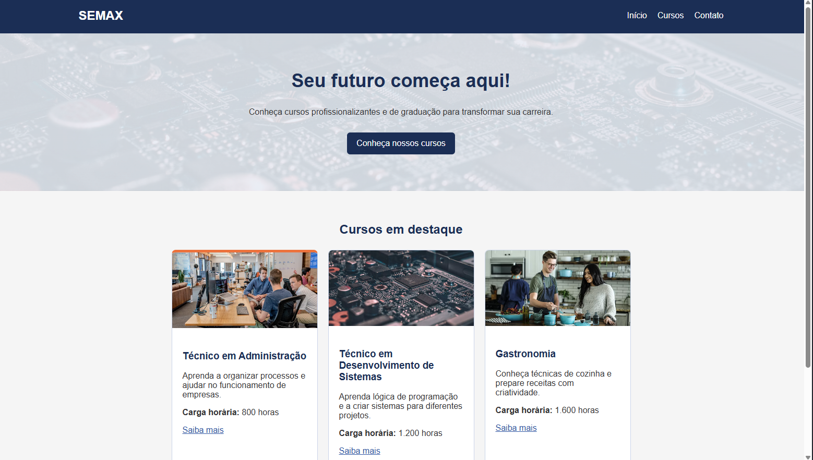

# SEMAX - Página de Cursos

Página desenvolvida para apresentar cursos profissionalizantes e de graduação.

## Sobre o projeto

O projeto foi criado como atividade de introdução ao desenvolvimento web. Ele apresenta uma página institucional com menu de navegação, banner principal, cards de cursos e informações de contato.

## Recursos

- Menu de navegação
- Apresentação da instituição
- Cards com cursos e carga horária
- Links para informações dos cursos
- Rodapé com contato
- Layout adaptado para telas menores

## Tecnologias

- HTML
- CSS
- Flexbox

## Como visualizar

Abra o arquivo `index.html` em qualquer navegador.
